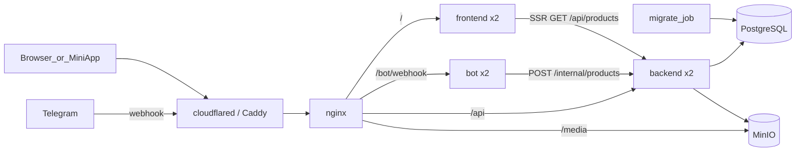

# План: shop_mvp

## Архитектура



Поток создания товара: админ отправляет фото с подписью, Telegram шлёт webhook на nginx, любая реплика бота скачивает фото в `BytesIO` и отправляет его multipart-запросом на `POST /internal/products` с заголовком `X-Service-Token`. Backend кладёт файл в MinIO (ключ `products/<uuid>.jpg`) и делает в PostgreSQL `INSERT ... ON CONFLICT (photo_file_unique_id) DO NOTHING`. Если товар уже был (повтор webhook), backend возвращает существующую запись.

## Структура

```
shop_mvp/
  AGENTS.md  Makefile  .env.example  docker-compose.yml  README.md
  nginx/nginx.conf
  scripts/check_stateless.py      # на Python, чтобы работало и на Windows, и на сервере
  docs/TELEGRAM_CHECKLIST.md
  backend/  pyproject.toml  Dockerfile  alembic.ini  alembic/
    app/domain/          product.py, ports.py (ProductRepository, ImageStorage)
    app/application/     create_product.py, list_products.py
    app/infrastructure/  db.py, repositories.py, storage_minio.py, settings.py
    app/api/             deps.py, routes_public.py, routes_internal.py, schemas.py
    app/main.py
    tests/
  bot/      pyproject.toml  Dockerfile
    app/main.py  app/handlers.py  app/backend_client.py  app/settings.py  app/keyboards.py
  frontend/ package.json  Dockerfile  next.config.mjs
    app/layout.tsx  app/page.tsx  app/TelegramInit.tsx
```

Make на Windows может отсутствовать. Цели Makefile — тонкие обёртки над `docker compose` и `uv run`, их можно запускать из Git Bash или WSL, а на будущем сервере они работают как есть. Логика проверок вынесена в Python-скрипты.

## Шаги

### 1. Обвязка и инфраструктура
- [AGENTS.md](shop_mvp/AGENTS.md):
  - стек и слои: domain не зависит ни от чего, application зависит только от domain, infrastructure и api — внешние слои;
  - запреты: polling, `MemoryStorage`, запись на диск (`open(..., 'w')`, `tempfile`), глобальные изменяемые объекты, кэши в памяти, миграции при старте приложения, прямой доступ бота к базе;
  - правило: после каждого шага запускать `make check`.
- [Makefile](shop_mvp/Makefile): `up` (с `--scale backend=2 --scale bot=2 --scale frontend=2`), `down`, `logs`, `migrate`, `lint` (ruff и eslint), `typecheck` (mypy и `tsc --noEmit`), `test` (pytest), `check` (lint, typecheck, test), `smoke` (запуск `scripts/check_stateless.py`).
- [docker-compose.yml](shop_mvp/docker-compose.yml): `postgres` (том и healthcheck), `minio` (том), `minio-init` (на образе `minio/minio`, в котором уже есть `mc`, — отдельный `minio/mc` в Docker Hub недоступен; создаёт бакет `products` и включает анонимное чтение, `mc anonymous set download`). Сервисы приложения добавляются на следующих шагах.
- [.env.example](shop_mvp/.env.example): `POSTGRES_*`, `MINIO_ROOT_USER/PASSWORD`, `S3_ENDPOINT`, `S3_BUCKET`, `PUBLIC_BASE_URL`, `PUBLIC_MEDIA_URL`, `BOT_TOKEN`, `WEBHOOK_SECRET`, `ADMIN_IDS`, `SERVICE_TOKEN`, `BACKEND_INTERNAL_URL`.
- Готово, когда `docker compose up -d postgres minio minio-init` проходит, `minio-init` завершается с кодом 0, а бакет существует.
- Проверка: `docker compose ps`, затем `docker compose run --rm minio-init mc ls local/products`.

### 2. Backend: домен, use cases и тесты
- Сущность `Product(id: UUID, title: str, image_key: str, photo_file_unique_id: str, created_at)`; порты `ProductRepository` (`add_if_absent`, `list`) и `ImageStorage` (`put`, `public_url`).
- Use cases: `CreateProduct` (валидирует название, загружает изображение, сохраняет; при дубле возвращает существующую запись, а лишний объект в хранилище удаляет) и `ListProducts`.
- Тесты в `backend/tests/` на фейковых адаптерах: создание товара, пустое название, повторный `photo_file_unique_id` даёт одну запись.
- Готово, когда тесты зелёные без Docker.
- Проверка: `cd backend && uv run pytest && uv run ruff check . && uv run mypy app`.

### 3. Backend: инфраструктура и API
- SQLAlchemy 2 async с asyncpg; engine создаётся в lifespan, сессия — на каждый запрос через `Depends`. Модель с `UNIQUE(photo_file_unique_id)`; Alembic-миграция `0001_products`.
- Хранилище MinIO через `aioboto3`: `put_object` из байтов в памяти.
- Роуты:
  - `GET /api/products` возвращает `[{id, title, image_url, created_at}]`, где `image_url = PUBLIC_MEDIA_URL + key`;
  - `POST /internal/products` (multipart: `title`, `photo_file_unique_id`, `file`) проверяет `X-Service-Token`, возвращает 201 для нового товара и 200 для дубля;
  - `GET /health` проверяет базу запросом `SELECT 1`.
- В compose добавить сервисы `migrate` (`alembic upgrade head`, одноразовый), `backend` (uvicorn, `depends_on: migrate: service_completed_successfully`) и `nginx` с маршрутами `/api` и `/media` (прокси на `minio:9000/products/`).
- Интеграционный тест с testcontainers или с compose-базой: дубль в реальной PostgreSQL даёт одну строку.
- Готово, когда `curl localhost/api/products` отдаёт `[]`, а `POST /internal/products` с токеном создаёт товар, картинка которого открывается по `/media/...`.
- Проверка: `make up`, затем `curl -F ... -H "X-Service-Token: ..." localhost/internal/products` и `curl localhost/api/products`.

### 4. Бот (aiogram 3, webhook)
- `app/main.py`: aiohttp-приложение с `SimpleRequestHandler(dispatcher, bot, secret_token=WEBHOOK_SECRET)` на `/bot/webhook`, `/health`. Хранилище по умолчанию не используется, состояние нигде не хранится.
- `setup_webhook` — отдельная команда (`python -m app.set_webhook`), а не код в `on_startup`, чтобы две реплики не спорили. Она вызывает `set_webhook(PUBLIC_BASE_URL + "/bot/webhook", secret_token=...)` и `set_chat_menu_button(MenuButtonWebApp)`.
- Хендлеры:
  - `/start` и любой текст: «У меня есть товар» и inline-кнопка `WebAppInfo(url=PUBLIC_BASE_URL)`;
  - команда «Создать товар» или `/create` от админа: подсказка «Пришлите фото с подписью — названием товара»;
  - фото с подписью от админа (фильтр `F.photo & F.caption` и `F.from_user.id.in_(ADMIN_IDS)`): `bot.download(photo[-1], destination=BytesIO())`, затем `backend_client.create_product(...)`, ответ «Товар создан» или «Такой товар уже есть»;
  - фото от не-админа: «Добавлять товары может только администратор»;
  - фото без подписи от админа: просьба добавить название.
- `backend_client`: `httpx.AsyncClient` создаётся в lifespan приложения, а не глобально на уровне модуля.
- Тесты: хендлеры с замоканным `backend_client` (проверка ветвления админ/не-админ/без подписи).
- Готово, когда тесты зелёные и в compose работают 2 реплики бота за nginx `/bot/`.
- Проверка: `cd bot && uv run pytest`, затем `make up` и `docker compose ps bot`.

### 5. Frontend (Next.js App Router)
- `app/page.tsx`: серверный компонент с `export const dynamic = 'force-dynamic'`, `fetch(BACKEND_INTERNAL_URL + '/api/products', { cache: 'no-store' })`, разметка `<h1>Каталог</h1><ul>` с `` и названием. Без CSS-фреймворков, `next/image` не используется (ему нужен кэш на диске).
- `app/layout.tsx`: `<Script src="https://telegram.org/js/telegram-web-app.js" strategy="beforeInteractive" />`; `TelegramInit.tsx` (`'use client'`) вызывает `window.Telegram?.WebApp?.ready(); expand()`. В обычном браузере ничего не происходит.
- `next.config.mjs`: `output: 'standalone'`; Dockerfile в два этапа (multi-stage).
- nginx: `/` проксируется на frontend.
- Готово, когда `localhost/` показывает «Каталог» и товары из шага 3, а `tsc` и `lint` чистые.
- Проверка: `cd frontend && npm run lint && npx tsc --noEmit`, затем `make up` и открыть `http://localhost/`.

### 6. HTTPS и Mini App
- `cloudflared tunnel --url http://localhost:80`. Полученный адрес вписать в `PUBLIC_BASE_URL` и `PUBLIC_MEDIA_URL`, перезапустить сервисы, затем выполнить `docker compose run --rm bot python -m app.set_webhook`.
- В README раздел про будущий сервер: Caddy перед nginx (автоматический Let's Encrypt), меняются только `.env` и повторный `set_webhook`.
- Готово, когда `/start` в Telegram показывает кнопку, а Mini App открывает каталог с картинками.
- Проверка: ручной чек-лист из шага 8.

### 7. Smoke-проверка stateless
- `scripts/check_stateless.py` (`httpx` и `subprocess` вызывают `docker compose`):
  1. поднять всё с `--scale ...=2`;
  2. создать товар через `/internal/products` (тестовая картинка генерируется в памяти);
  3. 20 раз запросить `/api/products` и `/` и убедиться, что ответили обе реплики (backend отдаёт заголовок `X-Instance` с hostname);
  4. остановить первую реплику backend, frontend и bot (`docker stop shop_mvp-backend-1` и т. д.) и повторить проверки;
  5. дважды отправить тот же `photo_file_unique_id` и проверить, что запись одна;
  6. выполнить `docker compose restart` и убедиться, что данные на месте.
- Готово, когда `make smoke` завершается с кодом 0.
- Проверка: `make smoke`.

### 8. Документация
- [docs/TELEGRAM_CHECKLIST.md](shop_mvp/docs/TELEGRAM_CHECKLIST.md), 6–8 пунктов: `/start`, кнопка меню, Mini App, фото с подписью от админа, повтор того же фото, фото от не-админа, фото без подписи.
- [README.md](shop_mvp/README.md): запуск, переменные окружения, установка webhook, раздел «Почему это stateless» (список решений), как проверить (`make check`, `make smoke`).
- Готово, когда с чистого клона по README поднимается рабочий стенд.
